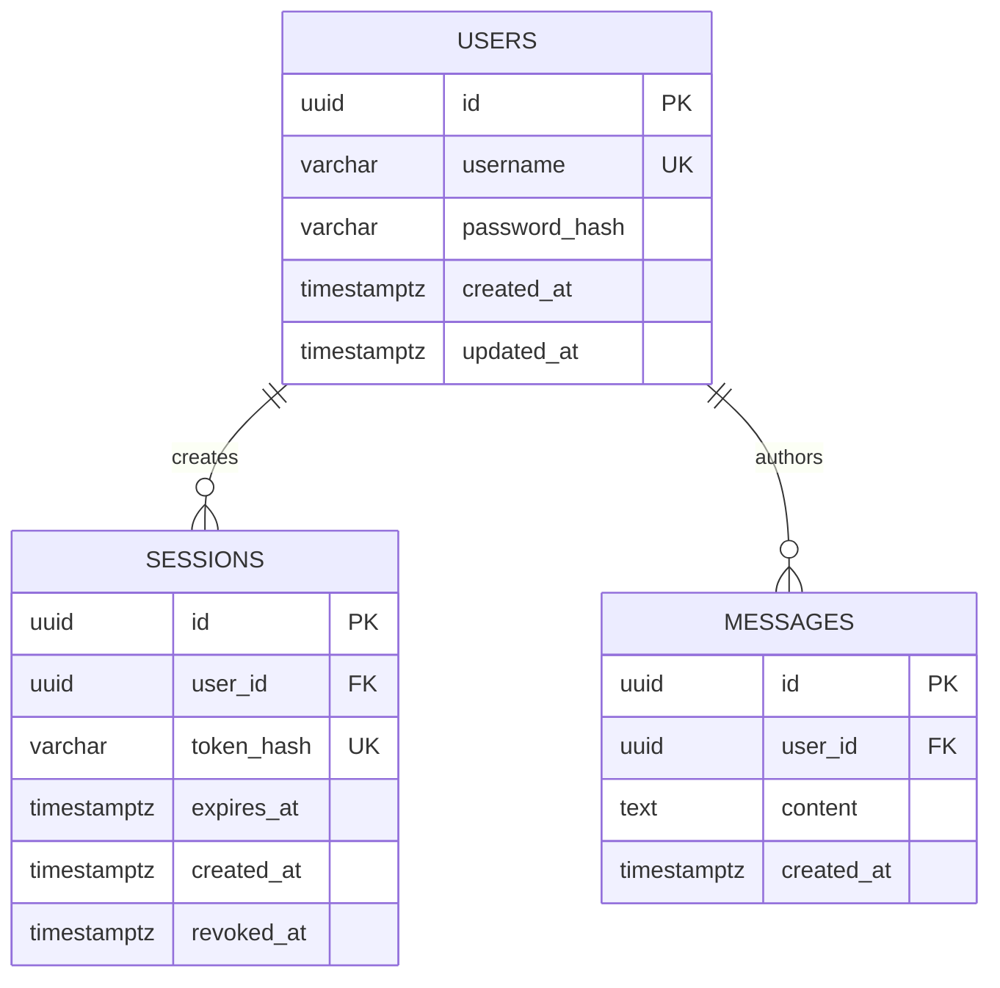

# SeisChat Database Design

PostgreSQL is the durable store for users, authentication sessions, and chat messages. SQLAlchemy provides the application mapping and Alembic manages schema migrations.

## Entity Relationship Diagram



## Tables

### `users`

Stores one record for each registered user.

| Column | Type | Constraints | Meaning |
| --- | --- | --- | --- |
| `id` | UUID | Primary key, generated | Stable user identifier |
| `username` | VARCHAR | Not null, unique | User-visible login/display name |
| `password_hash` | VARCHAR | Not null | One-way password hash; never plaintext |
| `created_at` | TIMESTAMPTZ | Not null, default | Registration time |
| `updated_at` | TIMESTAMPTZ | Not null, default | Last profile-record update |

Username normalization rules, maximum length, and case sensitivity are **TODO:
Team Decision Required**. Until those rules are agreed, the current model
enforces uniqueness on the exact username value stored. It does not normalize
case or whitespace; PostgreSQL's normal `VARCHAR` comparison is case-sensitive.
Update the model and uniqueness behavior when the team decides those rules.

### `sessions`

Stores server-recognized authenticated sessions. A session must reference one user and expire or be revoked before it can authenticate REST or WebSocket operations.

| Column | Type | Constraints | Meaning |
| --- | --- | --- | --- |
| `id` | UUID | Primary key, generated | Session identifier |
| `user_id` | UUID | Not null, foreign key to `users.id` | Session owner |
| `token_hash` | VARCHAR | Not null, unique | Hash of the session credential |
| `expires_at` | TIMESTAMPTZ | Not null | Session expiration time |
| `created_at` | TIMESTAMPTZ | Not null, default | Session creation time |
| `revoked_at` | TIMESTAMPTZ | Nullable | Logout/revocation time |

The raw credential is carried in a Secure, HttpOnly cookie. Only a hash should be stored in this table.

### `messages`

Stores messages sent in the single shared chatroom.

| Column | Type | Constraints | Meaning |
| --- | --- | --- | --- |
| `id` | UUID | Primary key, generated | Message identifier |
| `user_id` | UUID | Not null, foreign key to `users.id` | Author |
| `content` | TEXT | Not null | Message body |
| `created_at` | TIMESTAMPTZ | Not null, default | Original send time |

Messages use hard deletion in V1. A successful ownership-checked delete removes the row and clients receive `message_deleted`.

## Relationships

- One user can own many sessions.
- One user can author many messages.
- Each session belongs to exactly one user.
- Each message belongs to exactly one author.
- Deleting a user must not silently orphan messages; the final foreign-key delete behavior must be documented before user deletion is implemented.

## Constraints and Indexes

- `users.id`, `sessions.id`, and `messages.id` are primary keys.
- `users.username` is unique and not nullable.
- `sessions.token_hash` is unique and not nullable.
- Foreign keys use `sessions.user_id -> users.id` and `messages.user_id -> users.id`.
- Password hashes, session credentials, and secrets must never be stored in plaintext.
- `messages.content` must not be empty after the agreed input normalization.
- Index `messages.created_at` for chronological history retrieval.
- Index `messages.user_id` for ownership checks and user-related queries.
- Index `sessions.user_id` and `sessions.expires_at` for session validation and cleanup.

Exact UUID generation, message length limit, and foreign-key delete behavior are implementation details that must be documented before migrations are finalized. V1 deletion policy is hard deletion.

### Current model implementation

The current models map `users` and `sessions`; `messages` is reserved for a
later phase. UUID primary keys are generated by the application with Python's
UUID generator. `created_at` and `updated_at` have database defaults; SQLAlchemy
updates `updated_at` when an ORM update changes a user. All timestamp columns
use PostgreSQL `TIMESTAMPTZ`.

The `User.sessions` and `Session.user` relationships are the two directions of
the same one-to-many relationship. A session must reference an existing user.
No delete cascade is configured, so deleting a user with sessions is blocked by
the database foreign key rather than silently deleting or orphaning records.
`sessions.user_id` and `sessions.expires_at` are indexed for owner lookups and
expiry checks. Unique constraints on `users.username` and `sessions.token_hash`
also provide indexes for those unique values.

`password_hash` and `token_hash` are fields for already-hashed values. The model
does not hash credentials, accept raw session tokens, or implement
authentication workflows.

Alembic revisions are the source-controlled record of schema changes. From
`backend/`, apply the checked-in revisions with `alembic upgrade head`. Create
a new revision with:

```powershell
alembic revision --autogenerate -m "Describe the schema change"
```

Review the operations before applying the revision, and never edit a revision
already applied to a shared database. Use an isolated local/test database for
migration experiments; `alembic downgrade -1` reverses the most recent
revision's schema changes.

Run the backend model tests from `backend/` with `pytest tests/test_models.py`.
They use a fresh in-memory SQLite database per test, so they do not depend on
local or production data. Migrations target the PostgreSQL URL configured for
the backend and must be tested separately against an isolated PostgreSQL
database.

## Message History and Presence

History is queried from `messages` and is independent of a user's registration date. A newly registered user can retrieve older messages because history is not filtered by user creation time.

Online presence is a live application state derived from active authenticated WebSocket connections. It is not a permanent boolean on `users`, because a user may open more than one connection and a stale boolean would be difficult to reconcile. The connection manager should remove a user only after their last active connection closes.
